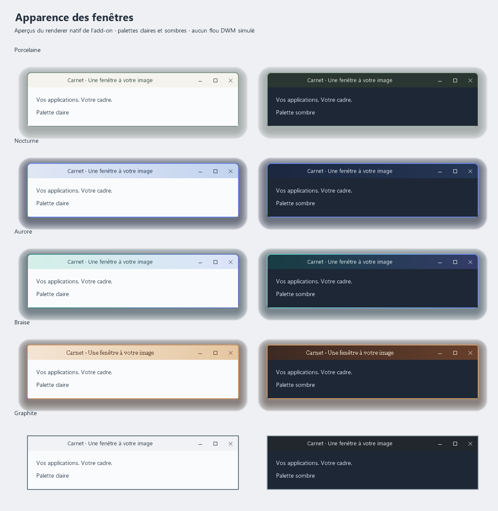

# Apparence des fenêtres

Configurateur A06 pour MyWallpaper, Windows x64. Les réglages et les sept préréglages apparaissent dans l’interface habituelle de MyWallpaper. Le companion `process-v2` utilise les API Windows et dessine ses décorations ; chaque comportement et chaque profil appartient à cet add-on.

Le manifeste contient **77 définitions : 68 valeurs et neuf sections**, sous la limite de 100 de DEC-0012. Aucun JSON n’est nécessaire pour les profils, couleurs, dégradés, titres, boutons, ombres ou les trois règles par application. Le générateur conserve une seule définition des valeurs, de leurs bornes et des profils pour le manifeste et le parseur C++.



Ces aperçus utilisent le renderer livré ; ce ne sont pas des captures d’applications tierces. Windows et Givre conservent le titre natif, dont le matériau dépend du host. Porcelaine, Nocturne, Aurore, Braise et Graphite emploient une barre de titre compagnon. Toutes les palettes ont une variante claire et sombre. Personnalisé déverrouille les détails ; les autres profils conservent leurs compositions. Les choix d’applications, thèmes, opacités, texte, boutons, modes de cadre et règles restent directement réglables.

Choisir les applications par leur nom `.exe`, une par ligne. La liste initiale contient `notepad.exe`. Une liste vide n’affecte rien, les exclusions ont priorité, puis la première règle avancée correspondante et la première règle lisible correspondante. Une règle lisible ajoute aussi ses applications à la sélection. Les processus système protégés et les surfaces du bureau/barre d’Explorer ne sont pas décorés. Les privilèges d’administration ne sont pas demandés.

| Réglages | Réalisation et limite |
| --- | --- |
| Opaque, Mica, acrylique, Mica profond | Attribut DWM système 38 ; il ne transforme pas le contenu opaque d’une application en verre. Selon le host et Windows, un setter accepté peut ne pas produire de matériau visible. |
| Bordures et états actif/inactif | Attribut natif quand possible, plus liseré externe uni ou dégradé, largeur 0–12 px. |
| Coins droits, petits, arrondis | Préférence DWM 33. Rayon précis 0–48 px par région Win32 ; cette découpe peut rogner le contenu et n’est pas un rayon du compositor DWM. |
| Ombres | Ombre additionnelle avec couleur, intensité, étendue, douceur et décalage. L’ombre Windows reste en place ; le réglage « Aucune ombre ajoutée » ne la supprime pas. |
| Titres | Couleurs natives ou titre compagnon au-dessus du contenu, uni/dégradé/translucide, alignement, police, poids, dimensions, texte et icône de classe si disponible. Le titre translucide ne floute pas le bureau. |
| Boutons | Boutons compagnons Réduire/Agrandir/Fermer, côtés, traits/pastilles/compact et survol. Le menu système et les raccourcis de l’application restent disponibles. Leur compatibilité d’usage dans chaque application doit être qualifiée. |
| Cadre demandé | Modifie les styles Win32 pour demander un cadre Windows. Chromium, WinUI, Office ou d’autres cadres personnalisés peuvent l’ignorer : aucune conversion universelle n’est annoncée. |
| Sans bordure / plein écran fenêtré | Styles et placement sur l’écran courant, avec restauration du placement si celui-ci correspond encore au placement appliqué. |
| Transparence | Alpha global de fenêtre, 35–100 %, premier/arrière-plan et règles. Les fenêtres ayant une transparence non récupérable via les attributs layered sont préservées. |
| Thème et écrans | Palettes clair/sombre, suivi de Windows, sélection tous/principal/secondaires, dimensions mises à l’échelle par le DPI de chaque fenêtre. |

Les fenêtres maximisées reviennent à leur cadre d’origine quand « Préserver les coins… » est actif ; le titre compagnon serait sinon hors de l’écran. Les fenêtres réduites, cachées ou cloaked sont restaurées puis réexaminées à leur retour. Il n’y a pas d’animation de fenêtre : A07 en conserve la propriété.

## Restauration

Le journal est validé avant chaque mutation. PID, date de création du processus et jeton posé sur la fenêtre évitent de restaurer un HWND recyclé. Pour les valeurs relisibles, l’add-on restaure uniquement les valeurs qui correspondent encore à ce qu’il a appliqué : les changements d’un autre propriétaire sont préservés. Les propriétés et décorations sont retirées à l’arrêt.

Sur le host testé, DWM relit les attributs 20, 33 et 38, mais refuse 34, 35 et 36 avec `E_INVALIDARG`. Le mode par défaut **préserve les attributs non relisibles**. « Appliquer les effets natifs non relisibles » permet leurs overrides avec un retour aux valeurs Windows à l’arrêt ; ce choix ne permet pas de retrouver ni de détecter une couleur native préexistante ou modifiée par un autre propriétaire. Les titres et bordures compagnons ne dépendent pas de ce choix.

Un processus gardien, lancé sans fenêtre, attend le processus propriétaire exact et tente sa restauration après sa sortie, y compris un crash. Il démarre avant le premier effet. La récupération après destruction forcée est testée. La perte simultanée du gardien, de son journal ou de l’accès aux fenêtres reste une limite ; les journaux non restaurés sont conservés. Le companion autorise une seule instance dans la session Windows.

## Construction locale

Prérequis : Visual Studio 2022 ou 2026 C++ x64 avec son CMake intégré, Node.js et Python pour les tests Windows locaux. Le générateur et l'instance CMake suivent la génération Visual Studio effectivement installée. La dépendance JSON sous MIT est incluse dans le dépôt : aucun checkout du moteur n’est nécessaire. Le SDK public MyWallpaper est utilisé séparément pour valider le manifeste, via `MW_CORE_ROOT` si son checkout n’est pas voisin.

```powershell
node tools/generate.mjs --check
node tools/validate-manifest.mjs
pwsh -NoProfile -File native/build.ps1
```

Le script construit, teste et produit `native/out/windows-x86_64/companion.exe` avec licences et notices. Un autre dossier de build peut être donné par `-BuildDirectory`. Sur un partage WSL sensible à la casse, MSBuild peut émettre ses avertissements de dépendances normalisées ; un dossier de build Windows local est préférable. L’exécutable attend les trames de MyWallpaper sur stdin/stdout ; il ne constitue pas une application de réglages indépendante.

Le transport suit le contrat public `process-v2` v5 de MyWallpaper ; les commandes et tous les effets restent à l’add-on. Ce chemin externe n’emploie ni injection, ni agent DLL, ni trampoline. Le build n’accède pas au code du moteur. Le manifeste est aussi contrôlé par le CLI et l’admission centrale. Le build central utilise `-SkipHostQualification` pour exécuter les contrats sans prétendre disposer du bureau Windows de l’utilisateur ; le build local sans ce paramètre exécute les tests HWND et de restauration complète.

## Vérification et travail restant

La compilation Release x64, la validation officielle du manifeste et des presets, les contrats C++, les tests de vrai HWND et l’intégration du companion sur deux processus de test séparés sont décrits dans [la qualification](docs/qualification.md). Les tests couvrent les arrêts, EOF, la destruction forcée, deux profils par application, la région, l’alpha et le placement.

Cette preuve porte sur **Windows 11 build 26200, des hosts Win32 créés pour les tests**, pas sur une certification de Notepad, Chromium, Office ou DWM. L’activation et cinq cycles arrêt/reprise via MyWallpaper ont aussi été vérifiés sur un host Win32 distinct. Le flou réellement visible, les applications à cadre personnalisé, Windows 10, les DPI physiques multiples, le multi-écran, les bureaux virtuels et l’accessibilité de la décoration restent à qualifier. Le contrat minimal des variantes privées manquantes et sa preuve de construction sont dans [les besoins techniques](docs/native-capabilities.md).

La publication de la première version est autorisée par le propriétaire. Les contrôles de construction et les limites de qualification sont décrits dans [le contrôle de publication](docs/release-qualification-2026-10-14.md). Le ledger courant reste l’autorité.

## Licence et provenance

MIT pour ce dépôt et les dépendances effectivement employées. Voir [les notices](THIRD_PARTY_NOTICES.md) et [l’étude source](docs/source-study.md). Aucun code Windhawk de décoration n’a été copié ou porté textuellement. Les variantes privées étudiées conservent leurs licences et ne sont pas incorporées au binaire.
